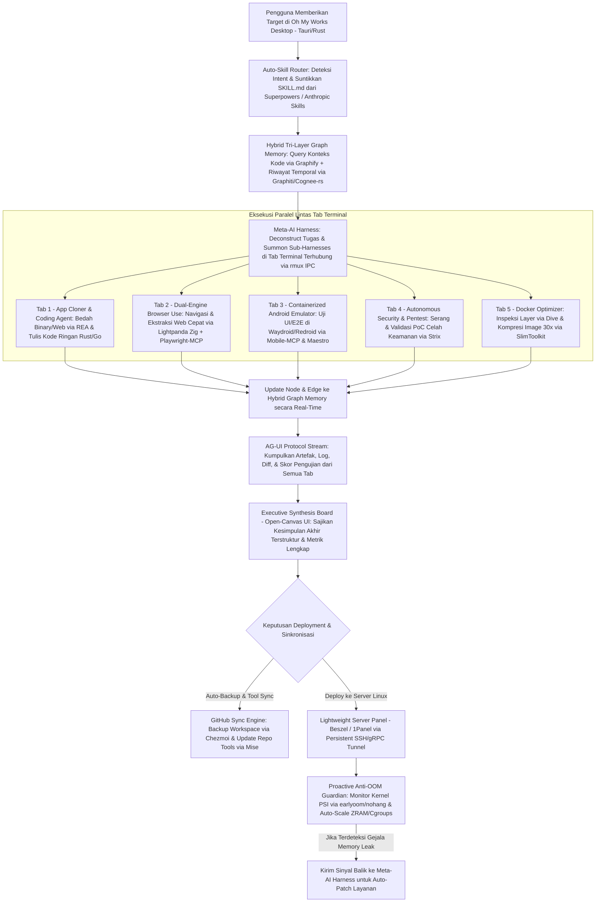

# Product Requirement Document (PRD): Oh My Works (OMW)

## 1. Klarifikasi Intent & Cakupan Ekosistem (Intent Clarification)

**Oh My Works (OMW)** dirancang untuk menyelesaikan masalah utama pengembang yang kehilangan banyak waktu akibat friksi operasional saat mengerjakan proyek menggunakan AI, ketiadaan ruang kerja (*workspace*) pribadi yang benar-benar sesuai keinginan di Linux, serta beban memori berlebih baik di desktop maupun di server *deployment*.

Seluruh spesifikasi dalam dokumen ini mengintegrasikan **8 Pilar Arsitektur** beserta repositori referensi GitHub yang telah terverifikasi untuk ditiru, digabungkan, dan dioptimalkan menggunakan bahasa kompilasi ringan (**Rust, Go, dan Zig**):

| Pilar Sistem | Repositori Referensi Utama | Stack / Bahasa | Kapabilitas Inti yang Diadopsi & Dioptimalkan |
| :--- | :--- | :--- | :--- |
| **1. Desktop Workspace & Multi-Terminal Orchestrator** | [tauri-apps/tauri](https://github.com/tauri-apps/tauri), [wavetermdev/waveterm](https://github.com/wavetermdev/waveterm), [helvesec/rmux](https://github.com/helvesec/rmux), & [zellij-org/zellij](https://github.com/zellij-org/zellij) | Rust & Go | Antarmuka desktop Linux ultra-ringan (~60 MB RAM saat *idle*) dengan *terminal multiplexer* terprogram via SDK agar setiap tab/pane terminal saling terhubung. |
| **2. Meta-AI Harness & Auto-Skill Standar Industri** | [smtg-ai/claude-squad](https://github.com/smtg-ai/claude-squad), [lastmile-ai/mcp-agent](https://github.com/lastmile-ai/mcp-agent), [obra/superpowers](https://github.com/obra/superpowers), & [anthropics/skills](https://github.com/anthropics/skills) | Go, MCP, & Markdown (`SKILL.md`) | *Supervisor AI Harness* yang mampu memanggil (*summon*) serta mengoordinasikan *AI harness* lain di tab terminal berbeda, dilengkapi *Auto-Skill Router* yang otomatis menyuntikkan standar industri (TDD, perencanaan arsitektur, *debugging* sistematis) sebelum eksekusi. |
| **3. Hybrid Tri-Layer Graph Memory** | [Graphify-Labs/graphify](https://github.com/Graphify-Labs/graphify), [getzep/graphiti](https://github.com/getzep/graphiti), [topoteretes/cognee-rs](https://github.com/topoteretes/cognee-rs), & [letta-ai/letta](https://github.com/letta-ai/letta) | Rust (`cognee-rs`), Tree-Sitter, & Python | Penggabungan *Structural Codebase Graph* ([Graphify](https://github.com/Graphify-Labs/graphify) — menghemat token hingga 71,5x sesuai studi [claude-code-memory-setup](https://github.com/lucasrosati/claude-code-memory-setup)) dengan *Temporal Knowledge Graph* ([Graphiti](https://github.com/getzep/graphiti) sesuai arsitektur [Graphify Issue #152](https://github.com/Graphify-Labs/graphify/issues/152)) di atas mesin memori Rust [cognee-rs](https://github.com/topoteretes/cognee-rs). |
| **4. Dual-Engine Browser Use** | [lightpanda-io/browser](https://github.com/lightpanda-io/browser), [microsoft/playwright-mcp](https://github.com/microsoft/playwright-mcp), [browser-use/browser-use](https://github.com/browser-use/browser-use), [skyvern-ai/skyvern](https://github.com/skyvern-ai/skyvern), & [steel-dev/steel-browser](https://github.com/steel-dev/steel-browser) | Zig (`Lightpanda`), TypeScript, & Python | Otomasi browser agen ganda: mesin utama berbasis Zig [Lightpanda](https://github.com/lightpanda-io/browser) (16x lebih hemat RAM dan 9x lebih cepat dibanding Chromium) dengan *accessibility snapshot* [Playwright-MCP](https://github.com/microsoft/playwright-mcp), ditambah *fallback* visual ke [Steel Browser](https://github.com/steel-dev/steel-browser) dan [Skyvern](https://github.com/skyvern-ai/skyvern). |
| **5. App Cloner (Reverse Engineering) & Security Tester** | [morluto/rea](https://github.com/morluto/rea), [usestrix/strix](https://github.com/usestrix/strix), & [tkellogg/open-strix](https://github.com/tkellogg/open-strix) | TypeScript (MCP) & Python | Inspeksi *binary*, *bundle* JS/Electron, dan lalu lintas jaringan via [REA](https://github.com/morluto/rea) untuk meniru fitur aplikasi besar secara presisi, dipadukan dengan agen *penetration testing* dinamis [Strix](https://github.com/usestrix/strix) untuk memvalidasi PoC celah keamanan dan *auto-fix*. |
| **6. Pengujian Emulator Android Linux Ringan** | [waydroid/waydroid](https://github.com/waydroid/waydroid), [remote-android/redroid-doc](https://github.com/remote-android/redroid-doc), [budtmo/docker-android](https://github.com/budtmo/docker-android), [mobile-next/mobile-mcp](https://github.com/mobile-next/mobile-mcp), & [mobile-dev-inc/Maestro](https://github.com/mobile-dev-inc/maestro) | C/LXC (`Waydroid`), Docker GPU (`Redroid`), & YAML/MCP | Menjalankan emulator Android berbasis kontainer kernel Linux ([Waydroid](https://github.com/waydroid/waydroid) di desktop Wayland atau [Redroid](https://github.com/remote-android/redroid-doc) / [docker-android](https://github.com/budtmo/docker-android) di kontainer) yang dikendalikan langsung oleh agen AI melalui [mobile-mcp](https://github.com/mobile-next/mobile-mcp) dan skenario E2E [Maestro](https://github.com/mobile-dev-inc/maestro). |
| **7. Optimasi Docker, Server Panel, & Anti-OOM Guardian** | [slimtoolkit/slim](https://github.com/slimtoolkit/slim), [wagoodman/dive](https://github.com/wagoodman/dive), [henrygd/beszel](https://github.com/henrygd/beszel), [1panel-dev/1panel](https://github.com/1panel-dev/1panel/), [rfjakob/earlyoom](https://github.com/rfjakob/earlyoom), & [hakavlad/nohang](https://github.com/hakavlad/nohang) | Go, C, & Rust | Analisis *layer* [dive](https://github.com/wagoodman/dive) dan pemangkasan kontainer hingga 30x lebih kecil via [SlimToolkit](https://github.com/slimtoolkit/slim), dipadukan dengan panel server ringan [Beszel](https://github.com/henrygd/beszel) + [1Panel](https://github.com/1panel-dev/1panel/) serta *daemon* [earlyoom](https://github.com/rfjakob/earlyoom) untuk mencegah dan memulihkan server dari Out-of-Memory (OOM). |
| **8. Executive Synthesis Interface & GitHub Sync** | [ag-ui-protocol/ag-ui](https://github.com/ag-ui-protocol/ag-ui), [langchain-ai/open-canvas](https://github.com/langchain-ai/open-canvas), [jdx/mise](https://github.com/jdx/mise), & [twpayne/chezmoi](https://github.com/twpayne/chezmoi) | TypeScript, Rust (`mise`), & Go (`chezmoi`) | Antarmuka *Synthesis Board* berbasis protokol [AG-UI](https://github.com/ag-ui-protocol/ag-ui) dan [Open-Canvas](https://github.com/langchain-ai/open-canvas) yang merangkum hasil akhir seluruh tab terminal, dilengkapi *auto-update tools* ([mise](https://github.com/jdx/mise)) dan *auto-backup* ruang kerja ke GitHub ([chezmoi](https://github.com/twpayne/chezmoi)). |

## 2. Simulasi Debat Multi-Peran (Multi-Role Debate Simulation)

### Putaran 1: Arsitektur Eksekusi, Bahasa Pemrograman, & Pengendalian Memori
* **Project Management (PM)**: Pengguna menginginkan aplikasi yang sangat kaya fitur—mulai dari *Meta-AI Harness*, *Browser Use*, *Reverse Engineering* ([REA](https://github.com/morluto/rea)), *Security Testing* ([Strix](https://github.com/usestrix/strix)), hingga emulator Android dan panel server—namun syarat mutlaknya adalah **sangat ringan, cepat, fokus di Linux, dan memangkas langkah manual**. Jika kita menggabungkan semua repo mentah (banyak yang berbasis Python dan Node.js) begitu saja, RAM pengguna akan habis sebelum aplikasi selesai dibuka.
* **Programmer (Principal Systems Architect)**: Setuju. Karena itu, **Oh My Works** tidak boleh menjadi *wrapper* Electron atau menjalankan puluhan proses Python secara terus-menerus. Kita membangun *Core Engine* menggunakan **Rust** ([tauri-apps/tauri](https://github.com/tauri-apps/tauri) untuk *shell* desktop dan [helvesec/rmux](https://github.com/helvesec/rmux) untuk *multiplexer* terminal) serta **Go** ([henrygd/beszel](https://github.com/henrygd/beszel) & [smtg-ai/claude-squad](https://github.com/smtg-ai/claude-squad) untuk agen jaringan/server). Untuk *Browser Use*, kita jadikan [lightpanda-io/browser](https://github.com/lightpanda-io/browser) (ditulis dengan bahasa **Zig**, tanpa mesin *rendering* grafis Chromium) sebagai mesin utama karena memakan memori 16x lebih kecil. Sementara itu, modul eksternal dari GitHub diambil melalui *pipeline* [jdx/mise](https://github.com/jdx/mise) dan secara bertahap dikompilasi atau dijalankan sebagai *on-demand micro-workers* via protokol MCP yang langsung dimatikan (*scale-to-zero*) begitu tugas di tab terminal selesai.
* **Designer (Lead UI/UX Architect)**: Dari sisi pengalaman pengguna, "ringan dan cepat" juga berarti **nol latensi visual dan nol langkah sia-sia**. Saya menolak tata letak bertumpuk yang mengharuskan pengguna membuka-tutup banyak modal. Kita gunakan sistem *Adaptive Tiling Workspace* ala [wavetermdev/waveterm](https://github.com/wavetermdev/waveterm) dengan transisi pegas (*critically damped spring*, `damping: 1.0`, `response: 0.35s`) dan bilah navigasi transparan (*backdrop-filter*) yang tidak memakan ruang kerja.

### Putaran 2: Orkestrasi Tab Terminal, Hybrid Graph Memory, & Auto-Skill Router
* **PM**: Bagaimana kita memastikan *Meta-AI Harness* bisa mengendalikan *AI Harness* lain di tab terminal berbeda, mengikuti standar industri secara otomatis, dan tidak pikun terhadap konteks proyek besar?
* **Programmer**: Kita menggabungkan 3 komponen di level sistem:
  1. **IPC Terminal Bus berbasis [rmux](https://github.com/helvesec/rmux)**: Setiap tab terminal bukan sekadar *shell* terpisah, melainkan *node* PTY yang terhubung ke *Unix Domain Socket* milik *Meta-AI Harness*. Saat *Meta-Harness* memanggil (*summon*) Tab 2 untuk *Browser Use* dan Tab 3 untuk [Strix](https://github.com/usestrix/strix), ketiganya berbagi *state* secara *real-time*.
  2. **Hybrid Tri-Layer Graph Memory**: Kita menyempurnakan [Graphify-Labs/graphify](https://github.com/Graphify-Labs/graphify) (yang memetakan AST kode dengan `tree-sitter`) dengan menambahkan [getzep/graphiti](https://github.com/getzep/graphiti) sebagai *Temporal Episodic Graph* di atas mesin Rust [topoteretes/cognee-rs](https://github.com/topoteretes/cognee-rs). Jadi agen tidak perlu membaca ulang ribuan baris file (hemat token hingga 71,5x), melainkan hanya melakukan *query subgraph* relevan dalam hitungan milidetik.
  3. **Deterministic Auto-Skill Interceptor**: Mengadopsi filosofi [obra/superpowers](https://github.com/obra/superpowers) dan [anthropics/skills](https://github.com/anthropics/skills), setiap *prompt* yang masuk dicegat oleh *Intent Classifier* lokal (<10 ms) yang langsung menyuntikkan `SKILL.md` wajib (misalnya `tdd-workflow`, `rea-reverse-engineer`, `strix-security-gate`, atau `docker-slim-deploy`) ke dalam *system prompt* *sub-harness* terkait.
* **Designer**: Agar pengguna tahu *skill* apa yang sedang aktif dan bagaimana tab terminal saling terhubung tanpa merasa pusing, setiap tab terminal wajib memiliki **Indikator Skill & Graph Node Badge** di bagian atasnya. Pengguna cukup melihat sekilas bahwa Tab 1 sedang menjalankan `SKILL: Superpowers/TDD` dan terhubung ke `Node: auth_service.rs` di memori Graphify.

### Putaran 3: Emulator Android Linux, Optimasi Docker, & Executive Synthesis Board
* **PM**: Pengguna menegaskan bahwa pengujian *mobile* dilakukan di **emulator** (bukan HP fisik), kontainer Docker harus dioptimalkan secara ekstrem, server harus kebal OOM, dan **hasil kesimpulan akhir dari semua tab terminal harus disajikan dalam antarmuka yang sangat bagus**. Bagaimana kompromi desain dan teknisnya?
* **Programmer**: Untuk emulator Android di Linux, menggunakan Android Studio AVD (QEMU penuh) akan menghabiskan 4–8 GB RAM dan memicu OOM. Solusi arsitekturnya adalah **Dual-Mode Containerized Android Emulator**:
  * Di Desktop Linux (Wayland): Menggunakan [waydroid/waydroid](https://github.com/waydroid/waydroid) yang berjalan langsung di atas *Linux namespaces/LXC* dan berbagi kernel dengan *host* sehingga nyaris tanpa *overhead* RAM.
  * Di Lingkungan Docker / Server Headless: Menggunakan [remote-android/redroid-doc](https://github.com/remote-android/redroid-doc) (GPU-accelerated Android in Docker) dengan *streaming* noVNC/WebRTC ringan dari [budtmo/docker-android](https://github.com/budtmo/docker-android), dikendalikan otomatis oleh AI melalui [mobile-next/mobile-mcp](https://github.com/mobile-next/mobile-mcp) dan [mobile-dev-inc/Maestro](https://github.com/mobile-dev-inc/maestro).
  * Untuk Docker & Server: Setiap *image* wajib melewati analisis [wagoodman/dive](https://github.com/wagoodman/dive) dan pemangkasan otomatis [slimtoolkit/slim](https://github.com/slimtoolkit/slim) (kompresi hingga 30x) sebelum dikirim ke *daemon* server ([henrygd/beszel](https://github.com/henrygd/beszel) + [rfjakob/earlyoom](https://github.com/rfjakob/earlyoom)).
* **Designer**: Dan untuk **Interface Hasil Kesimpulan Akhir Agent (Executive Synthesis Board)**, kita tidak boleh hanya menampilkan teks *chat* panjang! Ketika semua tab terminal selesai bekerja, protokol [ag-ui-protocol/ag-ui](https://github.com/ag-ui-protocol/ag-ui) akan memicu panel [langchain-ai/open-canvas](https://github.com/langchain-ai/open-canvas) yang menyusun **Kartu Sintesis Eksekutif Terpadu**: menampilkan *Executive Verdict Badge*, *Timeline Kontribusi Tiap Tab Terminal*, *Visual Architecture Diff Graph*, *Skor Keamanan Strix & Hasil E2E Emulator Maestro*, *Rasio Kompresi Docker Slim*, serta *Tombol One-Click Deploy & GitHub Backup* yang ditempatkan persis di bagian paling bawah (*Bottom-Anchored Action Bar*) agar pengguna tidak perlu *scroll* ke atas.

## 3. Nama Produk (Product Name)

**Oh My Works (OMW)** — *Autonomous Linux AI Workspace, Multi-Harness Terminal Orchestrator & Proactive Server Guardian*

## 4. Deskripsi Produk (Product Description)

**Oh My Works (OMW)** adalah aplikasi ruang kerja desktop *Linux-first* ultra-ringan (dibangun dengan inti **Rust, Go, dan Zig**) yang menyatukan orkestrasi *Meta-AI Harness* lintas tab terminal, otomasi *Dual-Engine Browser Use*, *reverse engineering* aplikasi besar ([REA](https://github.com/morluto/rea)), pengujian keamanan dinamis ([Strix](https://github.com/usestrix/strix)), pengujian emulator Android berbasis kontainer ([Waydroid](https://github.com/waydroid/waydroid) & [Redroid](https://github.com/remote-android/redroid-doc)), optimasi Docker ekstrem ([SlimToolkit](https://github.com/slimtoolkit/slim)), serta panel server anti-OOM ([Beszel](https://github.com/henrygd/beszel) & [earlyoom](https://github.com/rfjakob/earlyoom)) ke dalam satu antarmuka terpadu.

Dirancang khusus untuk *solo developer*, *software architect*, dan *AI engineer* yang menuntut kecepatan tinggi dan efisiensi memori maksimal, **Oh My Works** menghilangkan pekerjaan berulang melalui:
1. **Auto-Skill Injection**: Menyuntikkan standar industri ([obra/superpowers](https://github.com/obra/superpowers) & [anthropics/skills](https://github.com/anthropics/skills)) secara otomatis ke setiap agen tanpa perlu diinstruksikan berulang kali.
2. **Hybrid Tri-Layer Graph Memory**: Menggabungkan peta kode statis ([Graphify](https://github.com/Graphify-Labs/graphify)) dan memori kejadian lintas waktu ([Graphiti](https://github.com/getzep/graphiti)) di atas mesin Rust ([cognee-rs](https://github.com/topoteretes/cognee-rs)).
3. **Executive Synthesis Interface**: Merangkum hasil kerja paralel dari seluruh tab terminal menjadi satu dasbor kesimpulan akhir yang bersih, terukur, dan siap di-*deploy* atau di-*backup* otomatis ke GitHub ([chezmoi](https://github.com/twpayne/chezmoi) & [mise](https://github.com/jdx/mise)).

## 5. Alur Pengguna End-to-End (User Flow — Mermaid Diagram)

## 6. Tujuan dan Sasaran Produk (Product Goals and Objectives)

### A. Tujuan Utama (Primary Goals)
* **Orkestrasi Satu Pintu Tanpa Friksi (*Zero-Friction Multi-Agent Workspace*)**: Memangkas hingga 80% tindakan manual (*copy-paste* antar terminal, konfigurasi *skill* berulang, pindah jendela *browser*/emulator/panel server) dengan menyatukan seluruh siklus hidup pengembangan di dalam satu jendela [Tauri](https://github.com/tauri-apps/tauri) + [rmux](https://github.com/helvesec/rmux).
* **Konsumsi Sumber Daya Ultra-Ringan (*Extreme Lightweight Footprint*)**: Menjaga pemakaian RAM aplikasi desktop utama di kisaran **60–90 MB saat *idle*** dan mengganti komponen pengujian berat dengan alternatif berbasis sistem: [Lightpanda](https://github.com/lightpanda-io/browser) (Zig, **16x lebih hemat RAM** daripada Chromium) untuk *Browser Use* serta [Waydroid](https://github.com/waydroid/waydroid) / [Redroid](https://github.com/remote-android/redroid-doc) (LXC/Docker kernel-sharing) untuk emulator Android.
* **Sintesis Multi-Terminal yang Jelas & Mandiri (*Executive Synthesis Interface*)**: Menghadirkan antarmuka kesimpulan akhir berbasis [AG-UI](https://github.com/ag-ui-protocol/ag-ui) dan [Open-Canvas](https://github.com/langchain-ai/open-canvas) yang merangkum hasil kerja seluruh tab terminal secara otomatis dengan kesimpulan utama ditempatkan di bagian bawah (*bottom-anchored*) agar pengguna tidak perlu menggulir (*scroll*) ke atas.

### B. Tujuan Kedua (Secondary Goals)
* **Penguasaan Memori Konteks & Efisiensi Token (*Graphify + Graphiti + Cognee-rs*)**: Menurunkan konsumsi token prompt LLM hingga **71,5x** ([claude-code-memory-setup](https://github.com/lucasrosati/claude-code-memory-setup)) melalui pemetaan struktur kode lokal ([Graphify](https://github.com/Graphify-Labs/graphify)) yang dipadukan dengan memori kronologis lintas sesi ([Graphiti](https://github.com/getzep/graphiti) & [cognee-rs](https://github.com/topoteretes/cognee-rs)).
* **Kepatuhan Standar Industri Otomatis (*Zero-Prompt Auto-Skill Routing*)**: Memastikan 100% tugas *coding*, *testing*, dan *deployment* otomatis memuat panduan `SKILL.md` terverifikasi dari [obra/superpowers](https://github.com/obra/superpowers) dan [anthropics/skills](https://github.com/anthropics/skills) tanpa perlu diketik manual oleh pengguna.
* **Optimasi Kontainer & Pertahanan Server Anti-OOM**: Memperkecil ukuran *image* Docker hingga **30x** menggunakan [SlimToolkit](https://github.com/slimtoolkit/slim) dan [dive](https://github.com/wagoodman/dive), serta menjaga *uptime* server Linux hingga 99,9% melalui pencegahan OOM proaktif ([earlyoom](https://github.com/rfjakob/earlyoom) & [nohang](https://github.com/hakavlad/nohang)).

### C. Tujuan Ketiga (Tertiary Goals)
* **Akuisisi & Porting Otomatis Repositori GitHub**: Menarik *tools* baru dari GitHub secara otomatis menggunakan pola [jdx/mise](https://github.com/jdx/mise) dan menugaskan *AI Harness* untuk menerjemahkan modul yang lambat ke dalam bahasa Rust/Go.
* **Pencadangan Ruang Kerja Berkelanjutan (*Continuous GitHub Backup*)**: Mencadangkan seluruh konfigurasi, *graph memory snapshot*, koleksi *skill*, dan *state* proyek ke repositori GitHub secara terenkripsi menggunakan pola [twpayne/chezmoi](https://github.com/twpayne/chezmoi).

## 7. Skenario Kasus Ekstrem & Bottleneck Sistem (Edge Cases)

1. **Kasus Ekstrem 1 — Lonjakan Memori Mendadak (OOM Spike) di Server Saat Deployment Bersamaan**: Ketika server berspesifikasi rendah menjalankan beberapa kontainer aplikasi sekaligus dan tiba-tiba mengalami lonjakan trafik atau kebocoran memori (*memory leak*).
2. **Kasus Ekstrem 2 — Konflik Penulisan File (*Race Condition*) Antar-Tab Terminal**: Ketika *Sub-Harness* di Tab 1 (Coding) dan *Sub-Harness* di Tab 4 (Auto-Fix [Strix](https://github.com/usestrix/strix)) mencoba memodifikasi file kode sumber yang sama pada detik yang bersamaan.
3. **Kasus Ekstrem 3 — Halaman Web Target Menggunakan Anti-Bot Ekstrem atau Rendering WebGL/Canvas Berat**: Ketika mesin *headless* ringan [Lightpanda](https://github.com/lightpanda-io/browser) tidak dapat mengeksekusi komponen visual khusus atau tertahan oleh proteksi CAPTCHA/Cloudflare saat menjalankan *Browser Use*.
4. **Kasus Ekstrem 4 — Beban Ganda saat Emulator Android (Waydroid/Redroid) Berjalan Bersamaan dengan Kompilasi Rust/Docker Build**: Ketika mesin lokal pengguna memiliki RAM terbatas dan menjalankan emulator Android kontainer bersamaan dengan proses kompilasi paralel.
5. **Kasus Ekstrem 5 — *Stale Graph Node* pada Memori Graphify Saat Terjadi *Refactoring* Besar**: Ketika ratusan file berubah sekaligus dalam satu cabang Git sehingga struktur *graph* di memori lokal tidak lagi sinkron dengan kondisi *file system* terbaru.
6. **Kasus Ekstrem 6 — Kegagalan Kompilasi Saat *Auto-Porting* Repo GitHub ke Bahasa Ringan**: Ketika *AI Harness* mencoba menulis ulang *tool* Python/JS dari GitHub ke Rust/Go tetapi menemui ketergantungan *library* C/sistem yang tidak kompatibel.
7. **Kasus Ekstrem 7 — *Infinite Loop* atau Halusinasi pada Sub-Harness di Salah Satu Tab Terminal**: Ketika salah satu agen terminal terjebak dalam siklus percobaan pengujian yang gagal berulang kali dan menghabiskan kuota API/token.
8. **Kasus Ekstrem 8 — Kegagalan Koneksi atau Konflik *Merge* Saat *Auto-Backup* ke GitHub**: Ketika koneksi internet terputus atau terjadi perubahan simultan pada repositori *backup* GitHub.

## 8. Opsi Solusi & Strategi Fallback untuk Setiap Edge Case (Solution Options)

| Edge Case | Solusi Utama (Primary Architecture Mitigation) | Strategi Cadangan (Automated Fallback) |
| :--- | :--- | :--- |
| **1. Ancaman OOM di Server Linux** | Memasang sensor **Linux PSI (*Pressure Stall Information*)** via [earlyoom](https://github.com/rfjakob/earlyoom) & [nohang](https://github.com/hakavlad/nohang) yang terhubung ke agen [Beszel](https://github.com/henrygd/beszel). Saat tekanan memori menyentuh ambang 75%, sistem otomatis memperbesar kompresi **ZRAM**, memangkas *page cache*, dan membatasi `memory.high` pada `cgroups v2` kontainer non-kritis. | Menghentikan sementara (*graceful freeze/restart*) kontainer yang mengalami *memory leak*, lalu mengirim *stack trace* dan metrik memori ke *Meta-AI Harness* di desktop untuk membuat *patch* perbaikan otomatis. |
| **2. Konflik File Antar-Tab Terminal** | Menggunakan **Git Worktrees Terisolasi** (pola [claude-squad](https://github.com/smtg-ai/claude-squad)) ditambah *Graph Node Locking* di dalam [Graphify](https://github.com/Graphify-Labs/graphify), sehingga setiap tab terminal bekerja di *worktree* masing-masing dan hanya *Meta-AI Harness* yang berhak melakukan *atomic merge*. | Jika terjadi konflik baris kode saat penggabungan, *Meta-AI Harness* membuka tampilan *3-Way Semantic Diff* di *Executive Synthesis Board* untuk diselesaikan otomatis oleh agen *resolver* atau disetujui pengguna. |
| **3. Limitasi Render pada Lightpanda (Zig)** | Mendeteksi kegagalan *DOM/assertion* secara otomatis di dalam [Playwright-MCP](https://github.com/microsoft/playwright-mcp) dalam waktu <500 ms. | Melakukan *hot-handoff* sesi beserta *cookies* secara mulus ke mesin cadangan [steel-dev/steel-browser](https://github.com/steel-dev/steel-browser) + [skyvern-ai/skyvern](https://github.com/skyvern-ai/skyvern) (berbasis Computer Vision), atau menampilkan *Live Takeover View* jika membutuhkan otorisasi manusia. |
| **4. Beban RAM Emulator Android + Build** | Menjalankan [waydroid/waydroid](https://github.com/waydroid/waydroid) (atau [remote-android/redroid-doc](https://github.com/remote-android/redroid-doc)) di dalam profil `cgroups` dengan fitur *Dynamic Freeze* (`lxc-freeze`) otomatis ketika tidak ada skenario [Maestro](https://github.com/mobile-dev-inc/maestro) atau panggilan [mobile-mcp](https://github.com/mobile-next/mobile-mcp) yang sedang aktif. | Memindahkan (*offload*) eksekusi kontainer [Redroid](https://github.com/remote-android/redroid-doc) / [docker-android](https://github.com/budtmo/docker-android) ke server *remote* melalui *tunnel* SSH/gRPC dan hanya mengalirkan *stream* layar H.264/WebRTC ringan ke desktop. |
| **5. Stale State pada Hybrid Graph Memory** | Memasang *Incremental File Watcher* (`inotify` + `tree-sitter` incremental parsing) yang hanya memperbarui *node* dan *edge* [Graphify](https://github.com/Graphify-Labs/graphify) yang terdampak oleh perubahan *commit*/file dalam waktu <50 ms. | Menyimpan *timestamp validity* di [Graphiti](https://github.com/getzep/graphiti); jika suatu *node* terdeteksi usang saat di-*query*, agen otomatis membaca *diff* langsung dari Git sebelum mengambil keputusan. |
| **6. Gagal Auto-Porting Repo ke Rust/Go** | Mewajibkan siklus **Verifikasi Ekuivalensi Perilaku** menggunakan bukti ekstraksi dari [morluto/rea](https://github.com/morluto/rea) dan pengujian regresi otomatis sebelum mengganti *binary* asli. | Menjalankan *tool* asli di dalam *sandbox* ringan terkelola [jdx/mise](https://github.com/jdx/mise) sembari membungkusnya dengan *adapter* MCP berbahasa Rust/Go, tanpa memblokir pekerjaan utama pengguna. |
| **7. Infinite Loop pada Sub-Harness** | Menerapkan **Circuit Breaker & Token Budget Gate** di *Meta-AI Harness*: jika sebuah tab gagal melewati tes yang sama 3 kali berturut-turut, eksekusi dihentikan otomatis dan dialihkan ke skill `systematic-debugging` dari [obra/superpowers](https://github.com/obra/superpowers). | Mengisolasi log kegagalan dari tab tersebut dan menampilkannya sebagai kartu peringatan (*Action Required*) di *Executive Synthesis Board* dengan 3 opsi solusi instan. |
| **8. Kegagalan Auto-Backup GitHub** | Menyimpan seluruh perubahan dalam *Local Encrypted Git Queue* (pola [twpayne/chezmoi](https://github.com/twpayne/chezmoi)) dengan mekanisme *auto-commit* per *snapshot* tugas. | Melakukan sinkronisasi ulang (*background retry with exponential backoff*) saat koneksi pulih dan membuat cabang cadangan otomatis (`backup/auto-recovery-<timestamp>`) jika terdeteksi konflik *remote*. |

## 9. Bukti Pembuatan PRD (Proof of PRD Creation)

* **Debate Overview (Ringkasan Resolusi Debat Arsitektur)**:
  * **Resolusi Performa vs Fitur**: Disepakati penggunaan arsitektur inti berbasis **Rust ([Tauri](https://github.com/tauri-apps/tauri) + [rmux](https://github.com/helvesec/rmux) + [cognee-rs](https://github.com/topoteretes/cognee-rs))**, **Go ([Beszel](https://github.com/henrygd/beszel) + [claude-squad](https://github.com/smtg-ai/claude-squad) + [SlimToolkit](https://github.com/slimtoolkit/slim))**, dan **Zig ([Lightpanda](https://github.com/lightpanda-io/browser))** agar aplikasi tetap memakan RAM ~60–90 MB di desktop meskipun mengorkestrasi banyak agen dan fitur pengujian.
  * **Resolusi Emulator Mobile**: Mengganti mirroring HP fisik maupun emulator AVD/QEMU berat dengan **Containerized Android Emulator ([Waydroid](https://github.com/waydroid/waydroid) & [Redroid](https://github.com/remote-android/redroid-doc) / [docker-android](https://github.com/budtmo/docker-android))** yang dikontrol langsung via [mobile-mcp](https://github.com/mobile-next/mobile-mcp) dan [Maestro](https://github.com/mobile-dev-inc/maestro).
  * **Resolusi Memori & Standar Kerja Agen**: Menggabungkan [Graphify](https://github.com/Graphify-Labs/graphify) (*structural graph*) + [Graphiti](https://github.com/getzep/graphiti) (*temporal graph*) untuk penghematan token hingga 71,5x, serta menyematkan *Auto-Skill Router* dari [obra/superpowers](https://github.com/obra/superpowers) & [anthropics/skills](https://github.com/anthropics/skills).
  * **Resolusi UX Hasil Akhir**: Menghadirkan **Executive Synthesis Board** berbasis [AG-UI](https://github.com/ag-ui-protocol/ag-ui) & [Open-Canvas](https://github.com/langchain-ai/open-canvas) dengan tata letak *bottom-anchored takeaway* agar seluruh hasil kerja multi-terminal dapat dipahami dan dieksekusi dalam satu layar tanpa perlu *scroll* ke atas.
* **Date and Time**: `2026-11-01 09:00:35 WIB (UTC+7)`
* **Product Copyright**: `© 2026 Oh My Works (OMW). All rights reserved.`
